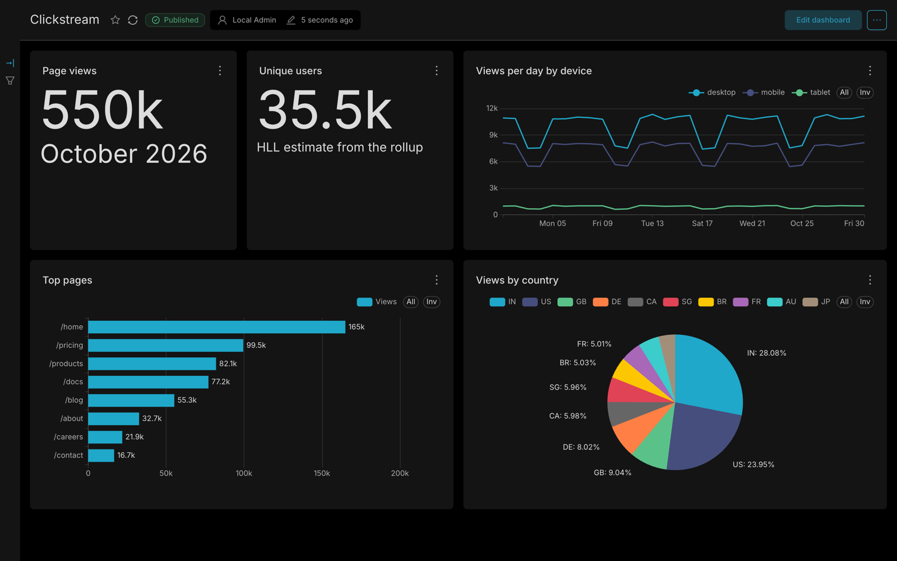

# Druid rollup and Superset dashboards

A month of clickstream data loaded into Apache Druid twice, raw and rolled up by hour, with an Apache Superset dashboard created from code. In the recorded run, rollup stored 5.1× fewer rows in 3.5× less space, kept every page view, and estimated unique users within 0.5%.



## What it shows

- **SQL-based batch ingestion.** Druid loads the file with `REPLACE INTO … SELECT … FROM TABLE(EXTERN(…))` ([`sql/`](sql/)), the same SQL you would use to query it, run as an ingestion task.
- **Rollup at ingestion.** `clicks_hourly` keeps one row per hour per page, country, and device, with a `views` count. Druid stores the summary instead of every click.
- **What rollup gives up, and what a sketch saves.** Individual user IDs are dropped, but an HLL sketch of them is kept in each row, so unique users can still be estimated for any filter or grouping.
- **A dashboard as code.** [`superset/provision.py`](superset/provision.py) creates the database connection, dataset, charts, and dashboard through Superset's REST API, so the dashboard is versioned and reproducible.

## How it works

```text
generate_data.py ──► data/generated/clicks.json (550,250 events, newline-delimited JSON)
                          │
       load.py ──► Druid SQL-based ingestion (multi-stage query engine)
                          ├──► clicks_raw     one row per click
                          └──► clicks_hourly  rolled up: hour × page × country × device,
                                              views = COUNT(*), users_sketch = DS_HLL(user_id)
                          │
 provision.py ──► Superset (pydruid) ──► dataset on clicks_hourly ──► 5 charts ──► dashboard
   compare.py ──► rows, storage, unique-user accuracy, and query time on both tables
```

- **Data** ([`scripts/generate_data.py`](scripts/generate_data.py)): seeded and with a fixed date range (October 1–30, 2026), so every run writes the same file. Traffic is uneven on purpose: busier in the afternoon (UTC) and on weekdays, with a few heavy users and many occasional ones.
- **Druid** runs from Druid's own Docker setup for 38.0.0, with the `druid-multi-stage-query` extension added. The data folder is mounted read-only where ingestion tasks run.
- **Superset** 6.1.0 runs from the official image plus the Druid driver ([`superset/Dockerfile`](superset/Dockerfile)), with its own metadata in SQLite.

## Run it

Requirements: Docker with **about 7 GB of memory** available to it (ingestion peaked at 6.3 GiB), and Python 3.10 or newer (standard library only).

```bash
# 1. Start Druid and Superset (the first run downloads about 1.2 GB of images, 3.8 GB on disk)
docker compose up -d --build

# 2. Generate the data and load both tables (about a minute)
python3 scripts/generate_data.py
python3 scripts/load.py

# 3. Create the dashboard (safe to run again)
docker compose exec superset python /app/provision.py

# 4. Compare the two tables
python3 scripts/compare.py
```

Open the dashboard at http://localhost:8088/superset/dashboard/clickstream/ (user `admin`, password `admin`). The Druid web console is at http://localhost:8888.

To stop: `docker compose down` (add `-v` to delete the Druid tables and Superset's metadata).

## Configuration

Defaults are for local use. To change them, copy `.env.example` to `.env`.

| Variable | Default | What it does |
|---|---|---|
| `SUPERSET_SECRET_KEY` | `local-only-not-a-secret` | Signs Superset sessions. Set a long random value for anything beyond your own machine. |
| `SUPERSET_ADMIN_PASSWORD` | `admin` | Password of the `admin` user, created on first start |
| `DRUID_URL` | `http://localhost:8888` | Druid router, used by the scripts on the host |

## What you'll see

Recorded on 2026-11-15:

- **Machine:** Apple silicon Mac, Docker 29.9.3 with 7.75 GiB for containers, Python 3.12.13.
- **Images:** `apache/druid:38.0.0` (amd64 only, run under emulation), `apache/superset:6.1.0` with `pydruid` 0.6.9, `zookeeper:3.5.10`, `postgres:17.6`.
- **Startup:** 86 seconds from `docker compose up -d --build` (images already downloaded) through loading both tables to a ready dashboard.
- **Data:** `data/generated/clicks.json` has SHA-256 `e037689af319c6f50aba1c5d8ae603ef3dd8e31adbea3f790937bdba512f1acf`. The same seed should give the same file.

**Ingestion.** Each table took about 30 seconds to ingest (`load.py`):

```text
Ingesting clicks_raw ... done in 30 s, 550,250 rows
Ingesting clicks_hourly ... done in 28 s, 107,725 rows
```

**Storage and accuracy** (`compare.py`):

```text
Storage
  table                rows  segments      size
  clicks_raw        550,250        30    16.3 MB
  clicks_hourly     107,725        30     4.6 MB
  rollup: 5.1x fewer rows, 3.5x less storage
  SUM(views) in clicks_hourly = 550,250 (raw rows: 550,250) -> no clicks lost

Unique users in the month
  exact, from clicks_raw:          35,670
  HLL estimate, from clicks_raw:    35,492 (-0.50%)
  HLL estimate, from clicks_hourly: 35,492 (-0.50%)
```

The exact count matches the generator (35,670 distinct users). The sketch gives the same estimate whether it is built from raw rows or merged from the hourly rows: rolling up loses no accuracy beyond the sketch's own.

**Query time.** Median of 10 runs with Druid's caches off, from two separate runs of `compare.py`:

| Query | raw, run 1 | hourly, run 1 | raw, run 2 | hourly, run 2 |
|---|---|---|---|---|
| views by page | 39 ms | 33 ms | 29 ms | 26 ms |
| views per day by device | 56 ms | 42 ms | 32 ms | 35 ms |
| unique users by country | 96 ms | 54 ms | 82 ms | 49 ms |

At half a million rows, simple counts are fast on both tables and the difference is within run-to-run noise. The clear gain is the unique-users query, which merges sketches over 5× fewer rows. Rollup's payoff grows with data volume; at this size, the main win is storage.

**Why 5.1×, not more.** Rollup merges rows that share a time bucket and all dimension values. An hour has about 760 events here, but page × country × device allows 240 combinations, so an hour keeps about 150 rows on average. Fewer dimensions, a coarser time bucket (a day), or more traffic per hour would raise the ratio.

**Memory**, from `docker stats`: about 4.5 GiB in total with Superset running and no ingestion in progress (historical 1.56 GiB, broker 1.0 GiB, coordinator 623 MiB, router 485 MiB, middleManager 391 MiB, Superset 379 MiB, ZooKeeper 95 MiB, PostgreSQL 21 MiB). During ingestion it peaked at 6.3 GiB (sampled every 2 seconds), because each ingestion task runs in its own JVM with a 1 GB heap.

A clean rerun from `docker compose down -v` reproduced every number above exactly: row counts, sizes, and the unique-user estimate.

## Limitations

- **Rollup is decided at ingestion.** `clicks_hourly` cannot answer questions about individual users, referrers, or anything finer than an hour. That is why this example keeps `clicks_raw` too; in production you would choose deliberately.
- **Sketches are estimates.** Unique users from HLL were 0.5% low here; the error depends on the sketch size and is not zero.
- **Single node, local storage.** Segments live on a Docker volume and Superset's metadata in SQLite. Production setups use object storage, a real metadata database, and more than one of each Druid process.
- **Druid has no arm64 images.** On Apple silicon the Druid containers run under emulation, so timings here are slower than on native hardware.
- **Local credentials.** `admin`/`admin` and a placeholder secret key are for your own machine only.

## Background

This example started as [data-visualization-druid-superset](https://github.com/SnehalAgrawal/data-visualization-druid-superset) (2025), a manual guide. It was rebuilt in November 2026:

- **Data:** 6 sample records became a seeded generator (550,250 events).
- **Ingestion:** the browser load wizard (served over a local HTTP server) became SQL-based ingestion from a script.
- **Superset:** a clone of the Superset repository became a pinned image.
- **Dashboard:** hand-built charts became a dashboard created from code.
- **Connection:** the database connection now points at the router. The guide used port 8081 (the coordinator), which does not serve SQL.
- **Rollup** and its measurements were added.
