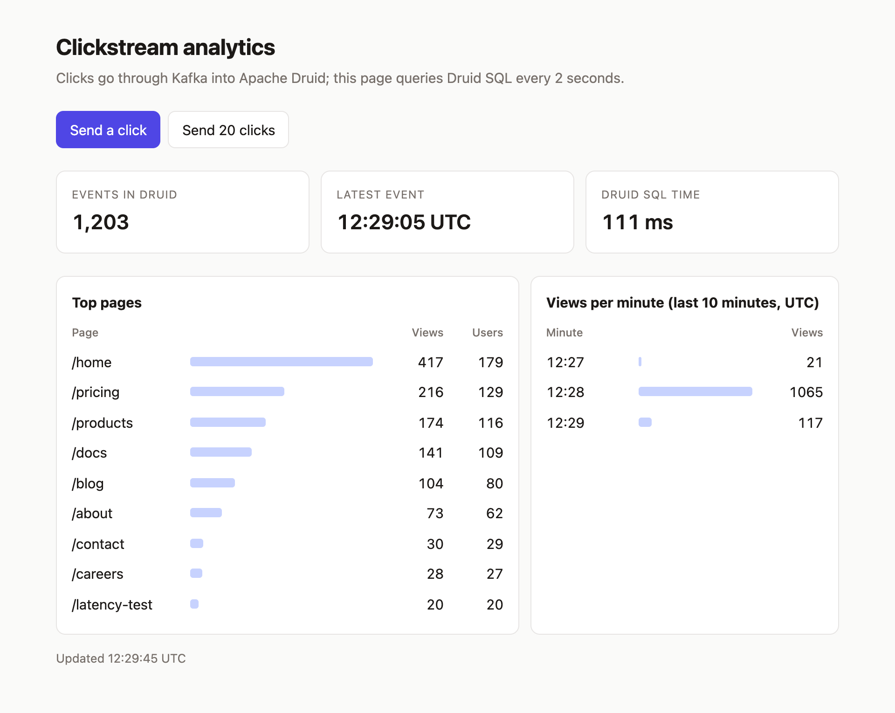

# Kafka → Druid streaming analytics

Click events go from a Node.js API through Kafka into Apache Druid's streaming ingestion, and are queried with Druid SQL. In the recorded run, a click was queryable a median of 72 ms after it was sent.



## What it shows

- **Streaming ingestion without batch jobs.** Druid's Kafka supervisor runs an ingestion task that reads the topic continuously. There is no loader to schedule: an event is in query results as soon as the task has read it.
- **How fast "real-time" is here.** `npm run latency` sends tagged clicks and polls Druid SQL until each one appears. On the run below, the median from `POST /click` to a query result was 72 ms.
- **Recent and older data, one query.** Druid answers a query from the ingestion task (recent events) and the historical process (segments already handed off) together, so the app never has to merge them.
- **What the stack costs locally.** About 5.5 GiB of memory across eight containers, measured below.

## How it works


- **App** ([`src/server.js`](src/server.js)): `POST /click` validates `{ userId, page }`, stamps the time on the server, and publishes the event to the `clicks` topic with `kafkajs`, keyed by user ID ([`src/kafka.js`](src/kafka.js)). `GET /stats` runs three Druid SQL queries in parallel ([`src/druid.js`](src/druid.js)).
- **Kafka** runs as a single node in KRaft mode (no ZooKeeper for Kafka).
- **Druid** runs as five processes from Druid's own Docker setup for 38.0.0: coordinator (also the overlord), broker, historical, middleManager, and router. ZooKeeper and PostgreSQL are Druid's coordination and metadata stores.
- **Ingestion spec** ([`supervisor.json`](supervisor.json)): JSON events, `timestamp` as the time column, `userId` and `page` as dimensions, no rollup (every click is a row), hourly segments.
- **Page** ([`public/index.html`](public/index.html)): plain HTML and JavaScript, refreshing every 2 seconds.

## Run it

Requirements: Docker with **at least 6 GB of memory** available to it, and Node.js 22 or newer.

```bash
# 1. Start Kafka and Druid (the first run downloads about 1.1 GB of images, 3.2 GB on disk)
docker compose up -d

# 2. Install, create the topic, and start Druid's Kafka ingestion
npm ci
npm run setup      # waits until Druid is reading the topic; safe to run again

# 3. Start the app, then open http://localhost:3000
npm start
```

In a second terminal:

```bash
npm run simulate -- --rate 20 --seconds 60   # synthetic traffic through the API
npm run latency -- --trials 20                # click → visible in Druid SQL
```

The Druid web console is at http://localhost:8888 (ingestion status under **Supervisors**, queries under **Query**).

To stop: `Ctrl+C` for the app, then `docker compose down` (add `-v` to delete Kafka and Druid data).

### Query Druid directly

```bash
curl -s http://localhost:8888/druid/v2/sql -H 'Content-Type: application/json' \
  -d '{"query":"SELECT page, COUNT(*) AS views FROM clickstream GROUP BY page ORDER BY views DESC LIMIT 5"}'
```

## Configuration

Defaults work with `docker-compose.yml`. To change them, copy `.env.example` to `.env`.

| Variable | Default | What it does |
|---|---|---|
| `PORT` | `3000` | Port for the app |
| `KAFKA_BROKERS` | `localhost:9092` | Kafka as seen from the host |
| `KAFKA_TOPIC` | `clicks` | Topic for click events (also set in `supervisor.json`) |
| `DRUID_URL` | `http://localhost:8888` | Druid router: SQL API and web console |

## What you'll see

Recorded on 2026-11-15:

- **Machine:** Apple silicon Mac, Docker 29.9.3 with 7.75 GiB for containers, Node.js 24.16.0.
- **Images:** `apache/druid:38.0.0` (amd64 only, run under emulation), `apache/kafka:4.3.2`, `zookeeper:3.5.10`, `postgres:17.6`.
- **Packages:** `express` 5.3.0, `kafkajs` 2.2.4.
- **Startup:** about 20 seconds from `docker compose up -d` (images already downloaded) to `npm run setup` finishing with Druid reading the topic.

**Latency.** `npm run latency -- --trials 20`, measured from `POST /click` to the first Druid SQL query that returns the event:

```text
Click sent → visible in Druid SQL, 20 trials (polling every 50 ms):
  min 61 ms · median 72 ms · p90 85 ms · max 206 ms
```

The first trial was the slowest (206 ms); the other 19 were between 61 and 90 ms. Each figure includes the HTTP request, the Kafka write, ingestion, and one SQL query, and it can be late by up to one polling interval (50 ms) plus the query time.

**Throughput check.** `npm run simulate -- --rate 20 --seconds 60` sent 1,182 clicks with no failures (the timer runs slightly under the requested rate). Afterwards Druid held exactly 1,203 events: 1,182 simulated, 20 latency trials, and 1 manual test click. Nothing was lost or duplicated.

**Memory**, from `docker stats` 30 seconds into the simulated traffic:

| Container | Memory |
|---|---|
| middlemanager (runs the ingestion task) | 1.92 GiB |
| historical | 1.24 GiB |
| broker | 871 MiB |
| coordinator | 595 MiB |
| router | 462 MiB |
| kafka | 365 MiB |
| zookeeper | 71 MiB |
| postgres | 38 MiB |
| **Total** | **about 5.5 GiB** |

These numbers come from one machine with Druid under amd64 emulation. They show the order of magnitude, not a benchmark.

## Limitations

- **Single node, no replication.** One Kafka broker, one partition, one ingestion task. Fine for learning; a production setup needs replication and more partitions.
- **Local deep storage.** Druid keeps segments on a Docker volume. Production clusters use object storage (S3, GCS, Azure) and a separate metadata database.
- **`kafkajs` is no longer maintained.** Its last release was February 2023. It works with Kafka 4.3.2 here, but on current Node.js it prints a harmless `TimeoutNegativeWarning` at startup. For new production code, consider Confluent's [`@confluentinc/kafka-javascript`](https://github.com/confluentinc/confluent-kafka-javascript), which offers a KafkaJS-compatible API.
- **Druid has no arm64 images.** On Apple silicon the Druid containers run under emulation, which uses more CPU and memory than native.
- **No authentication.** The API, Kafka, and Druid are open. Run it locally only.
- **Event time is set by the server.** The app stamps the time when it receives a click, not when the user clicked.

## Background

This example started as [real-time-analytics-druid-kafka](https://github.com/SnehalAgrawal/real-time-analytics-druid-kafka) (2025). It was rebuilt in November 2026 with:

- current versions (Druid 27 → 38, Kafka 7.5 with ZooKeeper → 4.3.2 with KRaft), all pinned
- Druid's official memory settings (the original gave each ingestion task 4 GB of heap)
- automated setup, input validation, and the latency measurement
